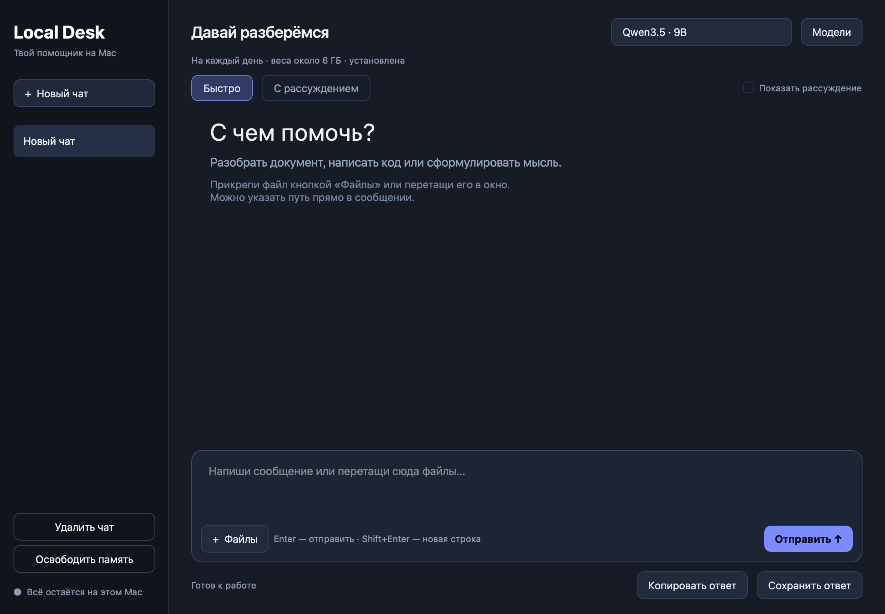

# Local Desk

Локальный ИИ-чат для **macOS 26+ и Apple Silicon (M1–M5)**. Отдельное настольное окно на Qt, MLX/Metal, работа с документами и сохранение истории. Без браузера и облачного API.



## Установка

Скачайте DMG из [Releases](https://github.com/Ivangruuu/local-desk/releases), откройте его и перетащите **Local Desk.app** в **Applications**. Python, Homebrew и Terminal пользователю не нужны.

Сборка v1.0 имеет локальную ad-hoc подпись и **не нотариализована Apple**. На другом Mac Gatekeeper может потребовать ручного разрешения запуска через настройки macOS. Сертификат Developer ID и нотариализация нужны для обычной публичной дистрибуции без такого подтверждения. Не отключайте защиту macOS.

### Если macOS блокирует запуск

При первом открытии скачанного приложения может появиться сообщение **«Файл „Local Desk“ не был открыт»** или **«Apple не удалось подтвердить, что файл „Local Desk“ не содержит вредоносного ПО»**. Это связано с отсутствием нотариального заверения Apple.

Если вы скачали приложение из [Releases этого репозитория](https://github.com/Ivangruuu/local-desk/releases):

1. Перетащите **Local Desk.app** в **Программы (Applications)** и попробуйте открыть его.
2. В предупреждении нажмите **Готово**.
3. Откройте **Системные настройки → Конфиденциальность и безопасность**.
4. Прокрутите до раздела **Безопасность** и нажмите **Всё равно открыть** рядом с сообщением о блокировке Local Desk.
5. Подтвердите действие паролем или Touch ID, если macOS попросит, и нажмите **Открыть**.

После разрешения приложение можно открывать обычным способом. На другом Mac или после повторного скачивания подтверждение может понадобиться снова. [Инструкция Apple](https://support.apple.com/ru-ru/102445).

### Загрузка модели

При первом запуске откройте **Модели**: скачайте модель с Hugging Face или выберите готовую папку с весами. Интернет нужен для загрузки моделей. После этого сообщения, документы и распознавание текста обрабатываются локально. Условия использования моделей доступны по ссылкам в приложении; лицензия приложения не заменяет лицензии весов.

| Модель | Вес файлов | Память Mac | Назначение |
|---|---:|---:|---|
| Qwen3.5 9B 4-bit | около 6 ГБ | от 16 ГБ | Основной вариант |
| Gemma 4 12B OptiQ 4-bit | около 9 ГБ | желательно 24 ГБ | Альтернатива Google |
| Qwen3.8 27B 4-bit | около 16 ГБ | от 24 ГБ | Тяжёлые задачи, ниже скорость |

Оценки памяти ориентировочные; загрузка и контекст требуют дополнительных буферов. На Mac с 24 ГБ большая модель подходит вплотную к лимиту памяти. Скорость и качество зависят от задачи; одинаковое качество всех моделей не гарантируется. Веса не включены в Git или DMG.

## Работа

- Выберите модель и режим **Быстро** / **С рассуждением**.
- Прикрепите файлы кнопкой, перетащите их в окно или укажите существующий путь в вопросе. Пути с пробелами заключайте в кавычки.
- Enter отправляет сообщение, Shift+Enter добавляет строку.
- **Остановить** завершает процесс генерации и освобождает память модели.
- Ответ можно скопировать или сохранить в TXT, MD, JSON, DOCX, PDF.

Поддерживается извлечение текста из PDF (включая сканы с локальным Apple Vision OCR), DOCX/DOC/RTF/ODT, XLSX/XLSM/XLS/XLSB/CSV/TSV/ODS, PPTX/ODP, EPUB/HTML/EML и изображений. Обычные текстовые файлы, Markdown, JSON, YAML, XML, логи и исходники читаются независимо от расширения.

Макросы и команды из документов не исполняются. Исходные файлы не изменяются. Изображения распознаются как текст; смысл картинок, диаграмм и сложной вёрстки не анализируется. Старые PPT, Pages/Numbers/Keynote, MSG, аудио и видео напрямую не поддерживаются.

Небольшие документы передаются целиком. Для длинных документов локальный поиск выбирает фрагменты, а чат показывает покрытие. Выборка не гарантирует полного анализа всего файла. Excel-формулы не пересчитываются: используются сохранённые значения. Для больших таблиц доступны числовые сводки; дублирующие итоги в исходной таблице могут исказить суммы.

Лимиты: 40 МБ/файл, 10 файлов/чат, 2 млн извлечённых символов, 50000 строк и 300 столбцов/лист, PDF до 250 страниц, OCR до 30 страниц/PDF. Контекст ограничен моделью; старые сообщения могут исключаться с уведомлением.

## Данные и перенос

Данные хранятся в `~/Library/Application Support/Local Desk/`: `data/chats.json`, `model-paths.json`, `models/`, `logs/`. При выборе готовой папки веса остаются в ней. Приложение можно перемещать отдельно от данных. Удаление `.app` не удаляет историю и модели.

Предыдущая установка в `~/Documents/Local-Qwen/models` распознаётся автоматически для совместимости. Новая версия не зависит от её Python/venv. Старую историю можно перенести копированием `data/chats.json` в одноимённый каталог данных нового приложения, предварительно закрыв приложение.

## Сборка из исходников

Нужны Apple Silicon, macOS 26+, Python 3.14 и Xcode Command Line Tools (`xcode-select --install`).

```sh
git clone https://github.com/Ivangruuu/local-desk.git
cd local-desk
./scripts/build_macos.sh
```

Результат: `~/Library/Caches/LocalDeskBuild/dist/Local Desk.app`. Каталог вывода специально находится вне синхронизируемых Desktop/Documents: файловый провайдер может добавлять Finder-метаданные внутрь пакетов и нарушать проверку подписи. Другой каталог можно задать через `LOCAL_DESK_DIST`. Python, Qt, MLX, Metal kernels, парсеры файлов и OCR входят в пакет. Сборка выполняется в изолированной `.build-venv`. Бинарники сторонних зависимостей определяют минимальную версию macOS; текущий MLX wheel требует macOS 26.

Запуск из исходников:

```sh
PYTHONPATH=src .build-venv/bin/python -m localdesk
```

Проверки:

```sh
PYTHONPATH=src .build-venv/bin/python -m unittest discover -s tests -v
"$HOME/Library/Caches/LocalDeskBuild/dist/Local Desk.app/Contents/MacOS/LocalDesk" --self-test
```

Для изолированного теста данных задайте `LOCAL_DESK_HOME`. `--self-test` проверяет Metal, чтение TXT/DOCX/XLSX/PDF и OCR на синтетических данных. В CI используется `--cpu-only`: эта проверка не подтверждает работу GPU. Для проверки весов используйте `scripts/check_release.py`. Для создания DMG/ZIP и контрольных сумм выполните `.build-venv/bin/python scripts/package_macos.py`.

## Лицензии

Код приложения: **AGPL-3.0-only**. Используется PyMuPDF под AGPL-3.0 и Qt/PySide6 под доступной LGPL-лицензией; полные уведомления зависимостей и исходники приложения вложены в `.app` в `Contents/Resources/Licenses` и `Source`. Qt поставляется как динамические библиотеки. Модели имеют отдельные лицензии; см. их карточки:

- [Qwen3.5 9B MLX](https://huggingface.co/mlx-community/Qwen3.5-9B-MLX-4bit)
- [Gemma 4 12B OptiQ](https://huggingface.co/mlx-community/gemma-4-12B-it-OptiQ-4bit)
- [Qwen3.8 27B MLX](https://huggingface.co/mlx-community/Qwen3.8-27B-4bit)
